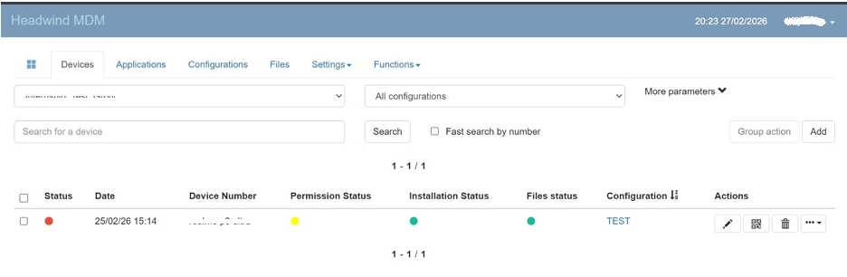
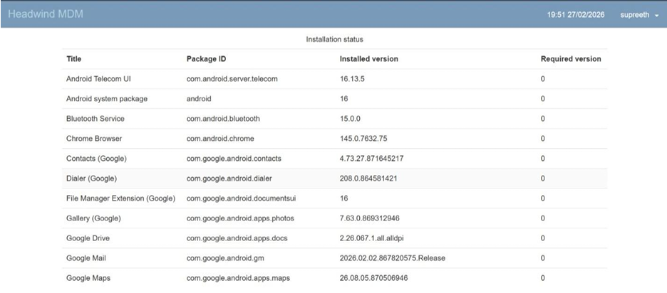
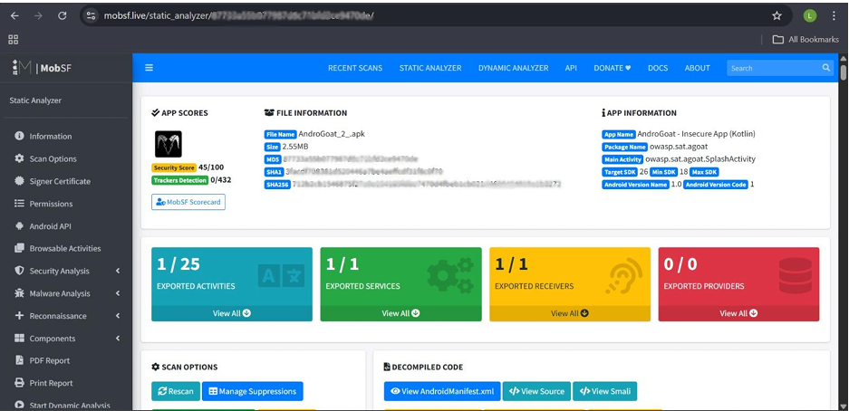
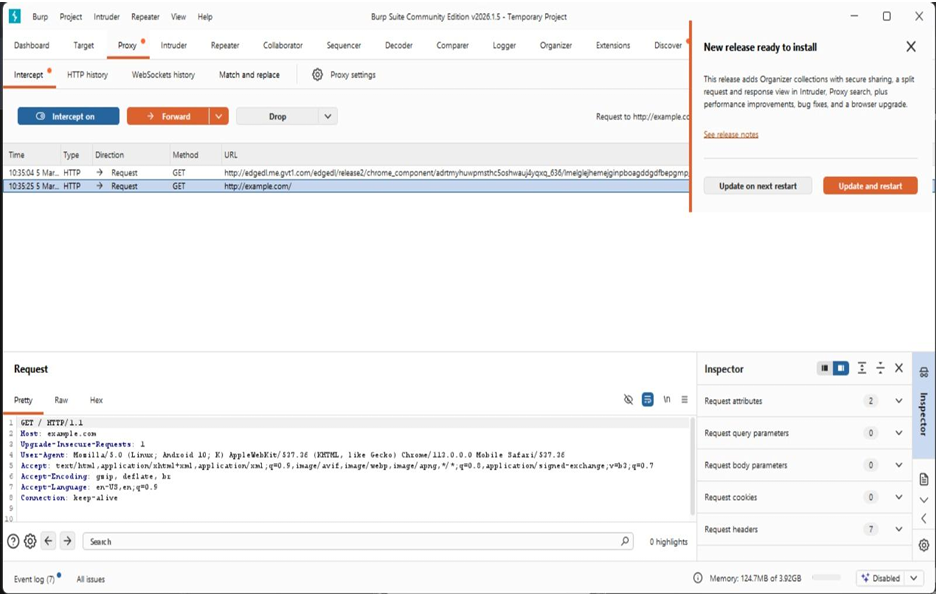

# 🔐 Android Security & Mobile Device Management Lab

**Cybersecurity Internship Project | Android Security | Mobile Application Assessment**

A hands-on cybersecurity internship project exploring Android device management, mobile application static analysis, and HTTP traffic inspection using industry-standard security tools.

---

## 📌 Project Overview

This project documents practical cybersecurity activities completed during my internship, focusing on two important areas of mobile security:

- 📱 **Mobile Device Management (MDM):** Exploring Android device enrollment, inventory management, and security policy configuration using Headwind MDM.
- 🛡️ **Mobile Application Security:** Exploring Android APK static analysis using MobSF and HTTP traffic inspection using Burp Suite Community Edition.

The repository presents the methodology, selected screenshots, technical observations, and learning outcomes from these activities.

## 🎯 Project Objectives

- Understand Android device enrollment and centralized device management.
- Explore device inventory and security policy configurations.
- Perform introductory static analysis of an Android application package.
- Understand HTTP request inspection using an intercepting proxy.
- Develop practical familiarity with mobile security assessment tools.

## 🧰 Tools & Technologies

| Tool | Purpose |
|---|---|
| Headwind MDM | Android device management and enrollment |
| MobSF | Android application static analysis |
| Burp Suite Community Edition | HTTP traffic inspection |
| Android Emulator | Controlled Android testing environment |
| AndroGoat | Intentionally vulnerable Android learning application |

## 🔍 Practical Work

### 1. 📱 Android Device Management — Headwind MDM

Explored centralized Android device management through the Headwind MDM platform.

**Activities performed:**
- Configured a device group and explored enrollment workflows.
- Enrolled an Android test device.
- Reviewed device inventory and installed applications.
- Explored remote device management options, including lock and wipe.
- Reviewed available device configuration and security policies.

**Key learning:** Android device enrollment, centralized inventory management, and mobile device security policy concepts.

### 2. 🔬 Android Application Static Analysis — MobSF

Used the Mobile Security Framework (MobSF) to explore static analysis of the AndroGoat Android application package.

**Activities performed:**
- Analyzed an Android APK using MobSF.
- Reviewed application information and scan results.
- Examined exported activities, services, receivers, and providers.
- Explored available security analysis and reporting sections.

**Documented observation:** The MobSF dashboard displayed a security score of 45/100 for the analyzed application.

This is the tool-reported score, not a standalone determination of the application's overall security.

### 3. 🌐 HTTP Traffic Inspection — Burp Suite

Explored proxy-based HTTP traffic inspection using Burp Suite Community Edition.

**Activities performed:**
- Explored the Proxy and Intercept interface.
- Reviewed HTTP request history.
- Inspected request methods, URLs, and headers.
- Examined request information using the Inspector panel.

**Key learning:** HTTP request structure, proxy-based traffic inspection, and the role of network analysis in application security testing.

**Evidence note:** The included screenshot demonstrates inspection of a GET request to `example.com`. It is evidence of Burp Suite usage, not proof that this specific request originated from AndroGoat.

---

## 📸 Project Screenshots

### 📱 Headwind MDM — Device Management

**MDM Dashboard**



**Android Device Inventory**



### 🔬 MobSF — Static Application Analysis



### 🌐 Burp Suite — HTTP Traffic Inspection



---

## 📂 Repository Structure

```text
android-security-mdm-lab/
│
├── README.md
│
├── docs/
│   └── methodology.md
│
└── screenshots/
    ├── mdm/
    │   ├── mdm-dashboard.png
    │   └── device-inventory.png
    │
    ├── mobsf/
    │   └── mobsf-analysis.png
    │
    └── burp/
        └── burp-traffic.png
```

## 📖 Technical Documentation

For more detailed information:

- 📄 [Technical Methodology](docs/methodology.md)
- 📸 [Project Screenshots](#project-screenshots)

## 💡 Key Learning Outcomes

Through these internship activities, I gained practical exposure to:

- Android Mobile Device Management fundamentals.
- Device enrollment and application inventory.
- Mobile application static analysis.
- HTTP request inspection and proxy configuration.
- Android application security concepts.
- Security assessment tools and technical documentation.

## ⚠️ Scope & Limitations

- This repository documents completed internship activities and selected evidence from the internship report.
- The original MDM and Android testing environments are no longer available.
- The repository does not contain a currently operational testing lab.
- No custom application or security automation code is included.
- No vulnerability exploitation or remediation is claimed without supporting evidence.

## 🛡️ Disclaimer

All activities described in this repository were performed as part of a controlled cybersecurity learning environment. Security testing tools and techniques should only be used on systems and applications for which appropriate authorization has been granted.

---

## 👨‍💻 Author

**Supreeth A**

Aspiring SOC Analyst | Cybersecurity Enthusiast

- 💻 **GitHub:** [Supreeth-A-cyber](https://github.com/Supreeth-A-cyber)
- 🔗 **LinkedIn:** [Supreeth A](https://www.linkedin.com/in/supreeth-a-822a47411/)

*Documenting practical cybersecurity learning and hands-on security projects.*
